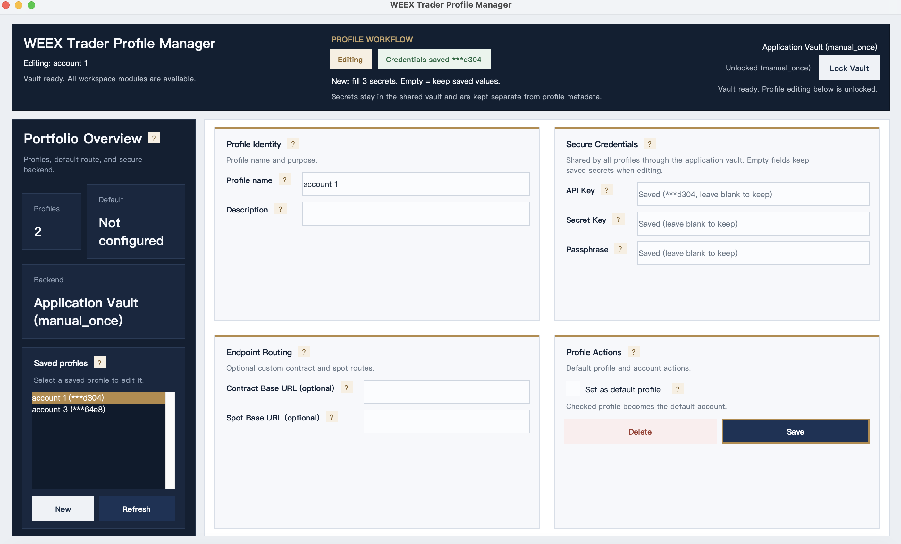

# WEEX Agent Skills User Guide

[中文](WEEX-Agent-Skills-用户指南.md)

> Document purpose: This guide is intended for first-time WEEX Agent Skills users. It covers installation, account configuration, skill selection, trade confirmation, and security guidance.
>
> Scope: The current WEEX Agent Skills release, including `$weex-trader-skill`, `$weex-analysis-skill`, `$weex-monitor-skill`, and `$weex-partner-skill`.
>
> Source: The `main` branch of the [official WEEX Agent Skills repository](https://github.com/weex-labs/weex-agent-skills). This guide was checked against commit `1bb9b95643ae8c914f5f7294ea7c989c0c803495` on 2026-09-08.
>
> Usage: Most features can be requested in natural language. Direct Python commands are normally required only for troubleshooting and advanced maintenance.

## Important notices

1. **Start with read-only queries before using trading features.** First verify public market data, account access, balances, and positions. Consider trading only after those checks succeed.
2. **Protect all credentials.** Enter the Secret Key, API Passphrase, and Application Vault password only in a local window or local terminal. Do not paste them into chat, public logs, or screenshots.
3. **Real-trading changes require explicit confirmation.** Orders, cancellations, leverage changes, and other account mutations can affect real assets. Review every confirmation field and reply only with the exact confirmation word shown by the AI tool.

Risk notice: This guide explains product features and operating procedures only. It does not constitute investment or trading advice and does not promise any trading outcome or return.

## 1. Product overview

A Skill is a capability package installed in an AI tool. After WEEX Agent Skills are installed, the AI tool can follow the repository's permission, confirmation, and safety rules when it queries WEEX data, analyzes trading records, manages monitor tasks, or queries WEEX Partner data.

| Skill | Responsibility | Main uses |
| --- | --- | --- |
| `$weex-trader-skill` | WEEX REST access and trade execution | Query markets, manage saved profiles, inspect balances and positions, preview orders, place orders, and cancel orders |
| `$weex-analysis-skill` | Read-only data analysis | Analyze PnL, fees, risk, and trading behavior in existing data |
| `$weex-monitor-skill` | Local unrealized-PnL monitor orchestration | Check futures-position unrealized PnL and, after authorization, execute a one-time close when the condition is met |
| `$weex-partner-skill` | Read-only WEEX Partner query orchestration | Query referrals, commission, sub-agent, relationship, and referral-asset data |

If you are unsure which Skill applies, describe the intended outcome and ask the AI tool to select the correct Skill:

```text
Select the appropriate WEEX Skill for checking my BTC futures position. Query only and do not perform any trade.
```

## 2. Prerequisites

### 2.1 Supported AI tools

The official repository provides installation paths for Codex, Claude Code, Cursor, GitHub Copilot, and OpenClaw. The first four use the standard installation flow. OpenClaw uses a fixed local Git checkout and Skill-directory symlinks.

### 2.2 WEEX account requirements

- **Public market data:** No WEEX login or API Key is required.
- **Balances, orders, or positions:** A WEEX account and a saved API profile are required.
- **Real orders, cancellations, or account-setting changes:** The API Key must have the necessary permissions, and the user must explicitly confirm the action. Automated strategies also require an active automated-trading authorization.
- **Existing JSON analysis:** A WEEX account connection is not required.
- **WEEX Partner queries:** The selected account must have the applicable WEEX Partner permissions.

An API is the interface used by software to exchange requests with WEEX. Users do not need to understand its implementation, but they must protect all three WEEX credential fields.

## 3. Install WEEX Agent Skills

### 3.1 Recommended: install through the AI tool

Send:

```text
Install all WEEX Agent Skills from https://github.com/weex-labs/weex-agent-skills into the current tool's Skill directory.
```

After installation, send:

```text
Check whether $weex-trader-skill, $weex-analysis-skill, $weex-monitor-skill, and $weex-partner-skill are available. Do not connect to my account or perform any trade.
```

Restart or reopen the AI tool if it requests that step.

### 3.2 Manual installation

Users familiar with a terminal can run:

```bash
npx skills add https://github.com/weex-labs/weex-agent-skills --all
```

`$weex-monitor-skill` and `$weex-partner-skill` both depend on `$weex-trader-skill`. Installing all four Skills is recommended.

### 3.3 Install from a local checkout

From the root of a downloaded or cloned official repository:

```bash
python3 tools/install_local_skills.py --all --agent codex
```

On Windows, `py -3` can be used instead of `python3`. Select the matching `--agent` value:

| Host | `--agent` value |
| --- | --- |
| Codex | `codex` |
| Claude Code | `claude-code` |
| Cursor | `cursor` |
| GitHub Copilot | `github-copilot` |

The local installer checks whether the current `gh skill install` supports the selected host. Installing Monitor or Partner by itself automatically includes Trader.

### 3.4 OpenClaw

Do not use the `npx` command above for OpenClaw. From a checkout that contains the target release, run:

```bash
bash skills/weex-trader-skill/scripts/update_openclaw_skills.sh
```

Production updates use the approved fixed release commit `e10c2089550159afb7247271d1041d9b415145cd` and do not follow a mutable branch. The updater validates Git objects, all four Skills, and the absence of submodules before switching symlinks and running OpenClaw eligibility checks. If any step fails, the previous checkout and symlinks are restored.

For later routine updates:

```bash
~/bin/update-weex-openclaw-skills.sh
```

If a target path already contains a real file or directory, the updater stops without overwriting user data. To restore the stable version, run:

```bash
bash ~/.openclaw/update-weex-openclaw-skills.sh
```

Verification commands:

```bash
openclaw skills list --eligible
openclaw skills info weex-trader-skill
openclaw skills check
```

Then run a read-only smoke test:

```text
Use $weex-trader-skill to query the latest BTCUSDT spot price. Query public market data only.
```

## 4. First use: verify public market data

Start without connecting an account:

```text
Use $weex-trader-skill to query the latest BTCUSDT spot price.
```

```text
Use $weex-trader-skill to show the BTCUSDT futures price change over the last 24 hours.
```

```text
Use $weex-trader-skill to query the current BTCUSDT funding rate and explain it in clear language.
```

These are public queries. They do not read private account data or create orders.

## 5. Configure WEEX account access

A saved profile is required before private account data can be queried or a trade can be performed.

Every time `$weex-trader-skill` is used, the AI tool refreshes preflight state. Before any private profile, Application Vault, or trading operation, the tool stops and explains the recovery path if dependencies are missing, environment settings are invalid, or preflight fails. Preflight does not install the managed GUI runtime implicitly.

### 5.1 Create WEEX API credentials

Create credentials from [WEEX API Management](https://www.weex.com/account/newapi/):

- **API Key:** Identifies the API permission set.
- **Secret Key:** Signs private requests and must remain confidential.
- **API Passphrase:** The passphrase paired with the API Key and Secret Key and must remain confidential.

Follow the principle of least privilege. If only queries are required, do not grant trading permission. Revoke or rotate credentials immediately if exposure is suspected.

### 5.2 Saved profiles and Application Vault

- **saved profile:** A local name and configuration for one WEEX API credential set, such as “main” or “read-only.” It does not create a new WEEX account.
- **Application Vault:** Encrypted local storage for API credentials.

A complete profile contains:

| Field | Required | Description |
| --- | --- | --- |
| Profile name | Yes | Human-facing name used in later requests |
| API Key | Yes | WEEX API Key |
| Secret Key | Yes | WEEX Secret Key used to sign private requests |
| API Passphrase | Yes | WEEX API Passphrase paired with the key and secret |
| Description/note | No | Account purpose or permission notes |
| Contract API URL | No | Empty uses `https://api-contract.weex.com` |
| Spot API URL | No | Empty uses `https://api-spot.weex.com` |
| Default profile | No | Allows private requests without repeating the profile name when the target is unambiguous |

A custom API URL must be a complete HTTPS URL under `weex.com`, one of its subdomains, `weex.tech`, or one of its subdomains. Keep these fields empty unless a specific test environment is intentionally required.

### 5.3 Windows or macOS

Ask the AI tool to open the local Profile Manager:

```text
Use $weex-trader-skill to open the English Profile Manager and create a saved profile locally. Use a local credential-entry method and do not ask me to paste secrets into chat.
```



*Figure 1: English Profile Manager. The interface shows saved profiles, Application Vault state, credential status, endpoint routing, and profile actions. Credentials are masked in the screenshot.*

On Windows and macOS, GUI flows must use the managed CPython 3.12.13 GUI runtime. System, Homebrew, Miniforge, and pyenv Python installations are not valid substitutes. The AI tool explains the pinned version, installer checksum, and dependency hashes and installs it only after explicit approval. Terminal profile management remains available if the managed GUI runtime is declined.

In the local window:

1. Initialize or unlock Application Vault.
2. Enter a profile name.
3. Enter the API Key, Secret Key, and API Passphrase locally.
4. Add an optional purpose or permission note.
5. Leave Contract and Spot API URLs empty to use official WEEX endpoints.
6. Optionally set the profile as default.
7. Save the profile and verify it with a read-only request.

### 5.4 Linux

For Linux desktop or interactive terminal use:

```text
Use $weex-trader-skill to start the English Linux account-setup wizard. Explain each step and use local credential entry.
```

Linux uses `manual_once` Application Vault mode. The Vault normally must be unlocked again after a reboot or session reset. This explicit step reduces the time credentials remain continuously available.

When creating Application Vault or changing its password, the user must choose and confirm the new password twice. Unlocking an existing Vault verifies the current password once. The AI tool must not infer, generate, or replace the Vault password. A forced reset is allowed only when the user explicitly intends to overwrite the existing Vault configuration.

### 5.5 Selecting among multiple profiles

If more than one usable profile exists, the AI tool displays profile names only and asks for a number or exact name:

```text
1. main
2. quant-bot
3. backup
```

The AI tool must not select a profile based on list order, notes, internal IDs, or name similarity. A valid selection can be reused in the same conversation until the user changes it or the reference becomes ambiguous.

### 5.6 Profile and Vault operations

Supported local operations include:

- Create, inspect, and list profiles
- Rename a profile or edit its description
- Rotate API Key, Secret Key, and API Passphrase
- Set or clear a default profile
- Delete a local profile
- Initialize, inspect, unlock, and lock Application Vault
- Change the Application Vault password

Confirm the target and impact before deleting a profile, resetting Application Vault, or rotating credentials.

### 5.7 Safe local credential entry

Prefer Profile Manager, the Application Vault UI, or secure terminal prompts for interactive use. Servers and automated environments can use environment variables or JSON through standard input. Do not place an API Key, Secret Key, API Passphrase, or Vault password directly on the command line, where it may appear in a process list, terminal history, or logs.

Advanced terminal options include `--prompt-secrets`, credential environment-variable arguments, and `--secrets-stdin-json`. One-shot, non-interactive Linux Vault operations may use a temporary password file. Keep temporary files outside the repository and delete them immediately after use.

## 6. Operation types and asset impact

| Operation type | Reads a private account | Can affect assets | Example |
| --- | --- | --- | --- |
| Public query | No | No | Price, klines, funding rate |
| Private read-only query | Yes | No | Balance, position, order history |
| Local operation | May read local settings | Normally no direct WEEX impact | Save a profile, create a monitor draft |
| Demo-trading operation | Yes | Changes WEEX demo data | Place a demo futures order |
| Real-trading operation | Yes | Yes | Place or cancel a real order, change leverage |

A demo-trading order is not a local dry run. It sends a mutating request to WEEX demo trading but does not use real assets.+

## 7. `$weex-trader-skill`: WEEX access, account management, and trading

This Skill owns WEEX REST access, saved profile and Application Vault management, and every live order action. Other Skills delegate real-time account reads or order execution to Trader.

### 7.1 Public market data

No account connection is required:

| Category | Available data |
| --- | --- |
| Basic information | Server time, supported assets and symbols, Spot or Futures product rules |
| Prices | Latest price, 24-hour change, best bid and ask |
| Market depth | Current bid and ask order-book data |
| Trades and trends | Recent trades, klines, historical klines |
| Futures-only data | Current and historical funding rates, index price, mark price, open interest |
| Connectivity | Public API connectivity checks |

Example:

```text
Use $weex-trader-skill to query the ETHUSDT spot price, 24-hour change, and best bid and ask. Show the result in a table.
```

```text
Use $weex-trader-skill to query the current BTCUSDT futures funding rate, mark price, and open interest and explain the result clearly.
```

### 7.2 Private read-only account queries

A usable saved profile is required. These operations do not create orders:

| Market | Available data |
| --- | --- |
| Futures | Balance, account configuration, one or all positions, commission rate, account bills, symbol configuration |
| Spot | Asset balances, trading status, fees, Spot bills, funding-account bills, transfer records, transaction records |
| Orders | Open and historical orders, individual order details, fills, conditional orders, and TP/SL state |

Futures private queries must identify **real trading** or **demo trading**. A profile name is not a trading-mode selection. Demo trading is currently available for Futures only.

Every natural-language result that uses private WEEX data or refers to a private order action starts with the current trading mode, for example `Current trading mode: real trading` or `Current trading mode: demo trading`. This first line is informational and is not an order confirmation.

```text
Use $weex-trader-skill with the “main” profile to show my real-trading Futures balance and all positions. Query only.
```

```text
Use $weex-trader-skill with the “practice” profile to show my demo-trading Futures balance, all positions, and historical orders.
```

Demo Futures currently supports balance, all positions, historical orders, and order placement. When no demo endpoint exists for fills, bills, open conditional orders, or TP/SL state, the tool reports degraded or incomplete data and never substitutes real-trading data.

### 7.3 Trading-history collection

Trader can normalize current or historical data for Analysis:

- Collect orders and fills for replay
- Collect data for a trading profile
- Collect an order-risk payload
- Collect a current account-risk payload

```text
Use $weex-trader-skill to collect the last 30 days of real-trading BTCUSDT Futures replay data from the “main” profile and save it as JSON. Do not trade.
```

JSON is structured text. Users can pass the file directly to `$weex-analysis-skill` without editing it.

### 7.4 Risk preview and account-risk checks

Supported flows include:

- Preview order risk before submission
- Preview a TP/SL conditional order
- Review current account risk without a pending order
- Report low available balance, concentration, leverage, missing TP/SL, and similar alerts

Risk output is advisory. It does not constitute investment advice or replace the user's independent judgment.

### 7.5 Orders, cancellations, and account settings

| Category | Supported operations |
| --- | --- |
| Futures orders | Place single or batch orders; cancel one, several, or all orders; close a direction-specific position |
| Futures conditional orders | Place or cancel conditional orders; place, modify, or cancel TP/SL orders |
| Spot orders | Place single or batch orders; cancel single or batch orders; cancel all orders for a symbol |
| Futures settings | Adjust isolated margin, change margin mode, enable or disable auto-append margin, update leverage |
| Order tracking | Query open orders, historical orders, individual status, and trade details |

Trader does not support WEEX Partner transfers or withdrawals. The ability to query transfer records does not authorize creating a transfer.

### 7.6 Standard order flow

For a real-trading Futures order:

1. Provide the profile, trading mode, symbol, direction, order type, quantity, and price.
2. The AI tool reads current account and market data.
3. The AI tool shows structured risk output and a complete order summary.
4. Review the profile, trading mode, side, quantity, price, fees, and alerts.
5. The tool submits only after the exact confirmation word shown in the preview is returned.
6. Query the order afterward to confirm whether WEEX accepted or filled it.

Private account queries and direct order actions require an explicit trading mode. If an order-preview request includes a profile and full order details but omits the trading mode, explicit user wording takes priority. If no useful signal exists, the initial preview uses real trading. A preview does not submit an order; the user may switch the mode and request a new preview.

```text
Use $weex-trader-skill to preview a real-trading BTCUSDT Futures limit long for the “main” profile at 60000 USDT with a quantity of 0.001 BTC. Preview only and wait for my explicit confirmation.
```

Only the exact human confirmation word returned by the preview is required. Internal intent IDs and risk signatures are managed by the tool. A stale, expired, or modified preview must be regenerated and cannot be reused.

### 7.7 TP/SL and price conditions

Price-triggered closes use official WEEX conditional orders:

```text
Use $weex-trader-skill to preview an official real-trading BTCUSDT long-position stop-loss order for the “main” profile with a trigger price of 58000. Do not submit it.
```

A full-position request does not require a separate quantity:

```text
Preview a real-trading stop-loss order for the full BTCUSDT long position at a trigger price of 58000. Do not submit it.
```

Do not create a local Monitor task for a price threshold. Use a WEEX official conditional order through Trader.

### 7.8 Automated strategy authorization

Automated authorization is for user-maintained Python or quantitative strategies using a saved profile in real trading. It does not discover arbitrary local scripts and does not support demo trading.

Supported operations include:

- Register, inspect, list, or permanently retire a stable strategy identity
- Create, inspect, grant, list, or revoke an authorization
- Submit guarded Spot or Futures orders within an authorization
- Inspect durable order events and notifications
- Reconcile local records with official read-only order facts
- Resolve uncertain usage records
- Back up and restore local authorization state
- Re-enable automated trading after verified recovery

Each strategy registers a stable strategy ID. A restart or rename reuses that ID; a copied strategy receives a new ID with independent authorization and quota. A retired strategy identity cannot request authorization again.

Every authorization defines exactly five dimensions:

1. Spot, Futures, or both
2. Specific symbols or all symbols
3. Maximum conservative U estimate per order leg
4. Maximum cumulative conservative U estimate for the validity period
5. A validity period greater than 0 and no longer than 720 hours (30 days)

Authorization does not separately restrict side, order type, minimum order amount, or order count. If cumulative quota is missing, the AI tool must ask for it and must not derive it from frequency, duration, target amount, per-leg limit, account balance, or expected order count. The final cumulative quota must match the user's input.

Granting authorization changes local authorization state and does not submit an order. During its validity period, eligible orders may skip per-order confirmation, but every order still passes official-data, product, balance, risk, scope, and quota checks. Accepted estimates continue to consume authorization quota for the period and are not refunded by later reconciliation. Expiry or revocation blocks future automatic reservations but does not cancel or modify an order already sent to WEEX.

Batch legs are validated and reserved together. A WEEX acceptance keeps the conservative estimated amount consumed; an explicit rejection releases the corresponding reservation; an uncertain result or order mapping becomes `REVIEW_REQUIRED` for manual review. The tool does not split, retry, or positionally guess a batch result.

A pending authorization request grants no trading authority and expires after 15 minutes. Authorization validity starts when the grant succeeds. Changing any scope dimension requires a new explicit grant that replaces the previous active authorization. Legacy authorizations containing removed expanded-scope fields remain auditable but require a new authorization under the current five dimensions before automated submission can continue.

Before approval, the confirmation shows the complete saved-profile name, masked strategy ID, Spot/Futures modules, symbol scope, per-leg limit, cumulative quota, projected validity, per-order-confirmation effect, revoke path, and local trust boundary. A real-trading automation can become active only when an end time no later than the authorization expiry is set in the same update. Unbounded active loops are prohibited.

Only official Spot or Futures operations with fresh, complete official market, product, balance, and risk data can use the automated path. Missing, stale, degraded, out-of-scope, over-quota, revoked, expired, conflicting, or unknown cases return to manual preview and confirmation without a WEEX write. Spot orders also validate official quantity rules and matching asset balances.

Full-position TP/SL always returns to manual confirmation because automated execution cannot prove a fixed quantity. Partial reduce-only requests also require official proof.

Ordinary accepted events may be summarized in a 60-second notification window; exception events are immediate. Notification is attempted once, and notification failure never changes order, authorization, or quota state.

Authorization-state snapshots retain 10 files by default and accept a configured range of 1 to 100. Restore accepts only a Trader-generated snapshot ID. Every syntactically valid restore attempt first disables automated trading. After restore, users must create fresh authorization where required, resolve all uncertain usage, and explicitly re-enable automated trading.

Snapshots and the authorization database rely on owner-only operating-system file permissions. They are not separately password-encrypted and are not uploaded or synchronized across devices. These controls reduce misuse and corruption but do not authenticate identity or protect against an attacker who controls the same OS user, Agent, Vault session, or API Key.

Automated-authorization state is unavailable on Windows until owner-only DACL creation and verification are implemented. Profile, Vault, GUI, and ordinary REST workflows on Windows remain supported.

### 7.9 Advanced and maintenance entry points

Trader also supports:

- Listing the available Spot and Futures endpoints
- Structured access through the checked-in official endpoint catalogs
- Short-term repeated ticker polling
- Python, environment, account, and GUI readiness checks
- Runtime dependency recovery
- Endpoint-catalog regeneration for maintainers

Use natural language for normal requests. Any underlying request that changes real account state still requires the applicable confirmation boundary.

Trader primarily uses REST. The repository's WebSocket page is supplementary reference material and does not mean the normal natural-language flow opens a persistent data stream.

## 8. `$weex-analysis-skill`: read-only WEEX analysis

Analysis reads input data only. It does not connect directly to a private account, place or cancel orders, or change profile or Vault state.

### 8.1 Eight analysis capabilities

| Capability | Description | Example |
| --- | --- | --- |
| Account snapshot analysis | Evaluate concentration, leverage, and available funds | `Analyze this account snapshot and rank the three main risks.` |
| Fill analysis | Summarize buys, sells, realized PnL, and fees | `Analyze these fills and calculate realized PnL after fees.` |
| Large replay preparation | Filter a large replay by symbol, account scope, or time | `Prepare this replay and keep only BTCUSDT for the last 30 days.` |
| Behavioral replay | Identify frequent trading, chasing, and holding-time patterns | `Review these trades and provide the three main behavior patterns with evidence.` |
| Trade-episode review | Reconstruct opening, adding, reducing, and closing into episodes | `Review these records by trade episode and highlight the key episodes.` |
| Trading profile | Summarize historical trading style, strengths, and weaknesses | `Generate a trading profile from this replay.` |
| Pre-order risk analysis | Explain Trader's normalized order-risk payload | `Analyze this order-risk JSON and list the alerts to review before confirmation.` |
| Current account-risk analysis | Review current account risk without a pending order | `Analyze this account-risk JSON and rank the main risks.` |

### 8.2 From a live account to an analysis

Live account data is first collected by Trader:

```text
Use $weex-trader-skill to collect the last 30 days of real-trading BTCUSDT Futures replay data from the “main” profile, then use $weex-analysis-skill to analyze trading behavior and fees. Keep the entire flow read-only.
```

The AI tool converts the data to the normalized JSON shape required by the selected analysis capability. A prose-only summary may omit fields and reduce completeness.

If Trader data includes `trading_mode`, `environment`, or `account_scope`, Analysis preserves those fields and displays `real trading` or `demo trading` in user-facing output. It must not infer a missing trading mode from a profile name or symbol. If environment context affects interpretation, the source environment must be requested.

### 8.3 Result interpretation

- Missing prices, leverage, or balances can produce a partial result. Missing fields must be disclosed and not inferred.
- A trading profile describes the historical sample and does not predict future market direction.
- Small samples receive basic observations rather than strong conclusions.
- Every analysis result is informational only and does not constitute investment or trading advice.

Every user-facing result includes the exact standard disclaimer below, without paraphrasing, shortening, or omission:

```text
Disclaimer: This result is generated solely from the current input data and is for reference only. It does not constitute any investment or trading advice. Please make your own independent judgment based on real-time data, official rules, and your own risk tolerance. Responsibility for related decisions and execution rests solely with the user.
```


## 9. `$weex-monitor-skill`: Futures-position unrealized-PnL monitoring

Monitor creates, confirms, stores, evaluates, and manages local monitor tasks. Trader still owns WEEX position reads and any authorized close order.

### 9.1 Supported monitor types

| Type | Metric | Trigger action |
| --- | --- | --- |
| `position_pnl_monitor` | WEEX unrealized PnL for one symbol and position side | One direction-specific market close |
| `order_baseline_pnl_monitor` | A local estimate based on fill price, fill quantity, current price, and side | One market close for exactly the baseline quantity |

Order-baseline PnL is a local estimate, not exchange-native isolated order PnL. WEEX position snapshots aggregate by symbol and position side, so confirmation still checks the full matching position.

### 9.2 Required request information

Provide:

- Saved profile
- Real trading or demo trading
- Futures symbol
- Long or short position side
- Comparison operator and numeric PnL threshold
- A direction-specific market-close action
- Optional close quantity for a position monitor; omission uses the freshly revalidated matching position size
- A positive baseline fill price and quantity for an order-baseline monitor; close quantity must equal baseline quantity
- A finite duration when creating and starting the monitor in one flow
- Optional check frequency; default 5 seconds and minimum 3 seconds
- Optional status-report interval; default 60 seconds, minimum 60 seconds, in whole minutes

```text
Use $weex-monitor-skill to create and start a real-trading BTCUSDT long-position unrealized-PnL monitor for the “main” profile. Market-close the long when unrealized profit is above 50 USDT, and run for one hour. Show the matched real-trading position and full confirmation before starting.
```

```text
Use $weex-monitor-skill to monitor a real-trading BTCUSDT long baseline for the “main” profile with fill price 60000 and quantity 0.001 BTC. When the local estimated unrealized profit is above 10 USDT, market-close 0.001 BTC. Run for 30 minutes and show the aggregate position before confirmation.
```

### 9.3 Confirmation

Before a real-trading or demo-trading monitor starts, the confirmation shows:

- Current trading mode. English confirmation and result reports start with `Current trading mode: real trading` or `Current trading mode: demo trading`
- Matched symbol, position side, and position size
- Entry price, current or mark price, leverage, margin mode, closable quantity, liquidation price, and position update time when returned
- Account available balance and confirmation snapshot time
- Aggregate unrealized PnL and, when a fixed quantity is specified, prorated unrealized PnL
- For order-baseline monitoring: baseline price, baseline quantity, current price, local baseline estimate, aggregate position size, and a warning that the estimate is not exchange-native isolated order PnL
- Trigger condition, close direction, close quantity, check frequency, finite duration, reporting interval, and one-shot behavior

A missing exchange field is shown as `not returned` and is never invented.

A task is not executable when required fields are missing, no matching position exists, position size is zero, input state is unknown, or position direction is ambiguous. The tool keeps the task as a draft or asks for manual handling and must not infer a direction and submit an order.

Reply only with the exact confirmation word shown. Monitor confirmation and execution authorization must match the displayed trading mode.

### 9.4 Task management

Supported operations include:

- Preview a draft without activating it
- Confirm and save a task
- List tasks and inspect task events
- Evaluate local sample positions in dry-run mode
- Perform one real-trading or demo-trading account check
- Run a bounded account loop
- Cancel an unfinished local task
- Report status periodically when the host provides a native scheduling capability

Dry-run still writes local task and event records for audit, but it never submits an order to WEEX.

Results and status reports are returned only to the current conversation. A report contains task state, condition, current value, threshold, trigger state, reason, and sanitized order or error summaries. It does not quote raw exchange responses, complete order JSON, or complete account snapshots.

Codex uses a task heartbeat for periodic reporting, Claude Code uses `/loop`, and OpenClaw uses cron. The host checks for an existing reporter before creating one. If the current host has no suitable native scheduling capability, monitoring can continue without automated periodic status reports.

Canceling a monitor cancels only the local monitor task. It does not cancel, amend, or retry an order already sent to WEEX and does not change an existing position. Periodic reporting stops when the task reaches `completed`, `cancelled`, or `review_required`.

A delegated execution failure records `review_required` and an event without silently retrying. Inspect task events before restarting anything to avoid a duplicate close.

### 9.5 Unsupported monitor requests

Monitor does not support:

- Price-threshold monitoring
- Opening, adding, reversing, or changing leverage
- Spot trading
- Grid trading, trailing stops, or arbitrary scripts
- One task operating across multiple accounts

Use a WEEX official conditional order through Trader for a price-triggered close.

## 10. `$weex-partner-skill`: read-only WEEX Partner queries

Partner is for accounts with WEEX Partner permissions. It reuses Trader-managed saved profiles and Application Vault and does not transfer funds, withdraw, or place orders.

Before a query, the AI tool runs Partner-safe preflight and exposes only non-secret profile identity, runtime state, and `partner_production` or `partner_test`. It does not expose a concrete test URL, API Key hint, or unrelated profile-routing metadata.

### 10.1 Seven query capabilities

| Capability | Returned information | Example |
| --- | --- | --- |
| Referral UID list | One referral or an explicitly confirmed all-referrals scope | `List referral UIDs for the official default time range.` |
| Direct-user trade and asset statistics | Deposits, withdrawals, Spot/Futures volume, and commission | `Query trade and asset statistics for UID 123456.` |
| Commission records | Commission with allowed coin and product filters | `Query commission for UID 123456 for the last seven days.` |
| Sub-agent statistics | Sub-agent volume, fees, and commission | `Query Futures statistics for sub-agent UID 123456 for the specified range.` |
| Referral verification | Whether one or more UIDs are direct referrals of the current Partner | `Verify whether UID 123456 is my direct referral.` |
| Referral assets | Asset data for one UID and an explicit date range | `Query referral assets for UID 123456 from 2026-08-01 through 2026-08-31.` |
| Referral deal data | Subordinate Spot or Futures deal data, excluding deposits, withdrawals, and commission | `Query Futures deal data for UID 123456 for the specified dates.` |

A UID must be a positive decimal integer within signed 64-bit range. Comma-formatted values, nested lists, and other encodings are rejected. Referral verification accepts multiple UIDs and automatically splits more than 100 UIDs into non-overlapping batches.

### 10.2 Required fields and defaults

| Query | Required information or default |
| --- | --- |
| Referral UID list | One UID or explicitly confirmed all-referrals scope; omitted time uses the official 90-day default segment |
| Direct-user trade and asset statistics | One UID or explicitly confirmed all-referrals scope; omitted time uses the official 90-day default segment |
| Commission | One UID or explicitly confirmed all-referrals scope; omitted time uses the official seven-day default and product type defaults to Spot |
| Sub-agent statistics | Sub-agent UID or confirmed all scope plus product type; production also requires time. A verified `partner_test` profile may use the upstream default with no claimed bounded range |
| Referral verification | One or more UIDs; result describes only direct-referral relationship to the current Partner |
| Referral assets | Exactly one UID and explicit start and end dates |
| Referral deal data | One or more UIDs, or confirmed all scope, plus explicit dates |

### 10.3 Query and result rules

- Omitted UID never means all referrals. “All referrals” must be explicit and confirmed.
- All-referrals scope does not automatically request a complete list or aggregate. Default output is a summary and up to the first 20 records. Ask explicitly for a complete list, all details, total, or aggregate.
- When an official endpoint offers several legal ranges and time is omitted, the smallest official range is used. Results show the actual UTC start and end.
- Chinese timestamps use `YYYY-MM-DD HH:mm:ss（UTC）` and English timestamps use `YYYY-MM-DD HH:mm:ss (UTC)`. Official date-only fields remain `YYYY-MM-DD (UTC)` without an invented time of day.
- Commission coin filter accepts only USDT or BTC.
- An explicit commission range longer than three calendar months starts with the latest three-calendar-month segment. The returned earlier-time action continues with a closed, non-overlapping range until the user's original start. Upstream rejection stops the process and no unbounded history limit is inferred.
- Use exactly the returned continuation object and one returned action. Do not reconstruct or edit the bound profile, environment, scope, operation, filters, result mode, contract version, or actual time range from memory.
- Reusing a continuation may repeat or overwrite coverage for the same page or time segment.
- Offset pagination is not a stable snapshot; data may change between pages. After interrupted pagination, a complete result must restart at page 1 and must not combine old and new pages as if they were one complete result.
- Rate-limit exhaustion, timeout, or incomplete range stops without automatic retry.
- Empty output means only that the current query returned no records.
- Results show profile, scope, actual UTC range, complete or partial coverage, summary, displayed records, continuation instructions, warnings, and a safe recovery action. Partial data is never labeled as a complete total.
- Known business fields use the official Chinese or English description and retain the original field name. Unknown response fields may expose a field name or hidden count but never the value, and their meaning is not inferred from spelling.
- `is_referral=false` means only that the UID is not a direct referral of the current WEEX Partner. It does not prove the account does not exist or identify another Partner.
- Partner production is the default. A strictly validated saved HTTPS `https://*.weex.tech` test subdomain may be labeled `partner_test`. Results show only `partner_production` or `partner_test`, never the concrete test origin. API-base environment overrides and authenticated redirects are rejected.
- Partner does not persist business responses itself, but the AI host's chat or tool transcript may retain query inputs and outputs. Do not promise host retention, access, or deletion behavior.

### 10.4 Unsupported WEEX Partner requests

- Transfers, withdrawals, or any other Partner write
- UID-to-phone or UID-to-email identity checks
- Cross-Partner queries
- Silently interpreting ambiguous “trading statistics” as either funding or deal volume

When intent is ambiguous, the AI tool asks whether the user needs deposits, withdrawals, or commission, or deal-volume-only statistics.+

## 11. Common natural-language requests

### 11.1 Public market data

```text
Use $weex-trader-skill to query the latest BTCUSDT spot price, 24-hour change, and best bid and ask. Use public data only.
```

### 11.2 Real-trading positions

```text
Use $weex-trader-skill with the “main” profile to show real-trading BTCUSDT long and short positions, available balance, and unrealized PnL. Read only and do not trade.
```

### 11.3 Demo trading

```text
Use $weex-trader-skill with the “practice” profile to show all demo-trading Futures positions and historical orders. Read only.
```

### 11.4 Collect and analyze recent trades

```text
First use $weex-trader-skill to collect the last 30 days of real-trading BTCUSDT Futures replay data from the “main” profile. Then use $weex-analysis-skill to analyze net PnL, fees, holding time, and trading behavior. Keep the entire flow read-only.
```

### 11.5 Preview a Spot order

```text
Use $weex-trader-skill to preview a real-trading Spot market order that buys BTC with 200 USDT for the “main” profile. Show asset checks, estimated amount, and risk alerts. Do not submit.
```

### 11.6 Preview a Futures order

```text
Use $weex-trader-skill to preview a real-trading ETHUSDT Futures limit short for the “main” profile at 2500 USDT with quantity [...]. Show account, direction, quantity, price, and risk information. Do not submit.
```

### 11.7 Create a position-PnL monitor

```text
Use $weex-monitor-skill to create and start a real-trading BTCUSDT long-position monitor for the “main” profile. Market-close the long when unrealized PnL is below -30 USDT and run for two hours. Show the matching position and complete confirmation first.
```

### 11.8 Query WEEX Partner commission

```text
Use $weex-partner-skill with the “partner-main” profile to query Spot commission for the official default time range. Report the actual UTC range, whether coverage is complete, and whether another page is available. Read only.
```

## 12. Writing an effective request

Use this structure:

```text
Skill + saved profile + real/demo trading + symbol or UID + requested action + time or trigger + read-only/preview/confirmation boundary + output format
```

Example:

```text
Use $weex-trader-skill + main profile + real trading + BTCUSDT + show orders for the last seven days + read only + table output.
```

The plus signs are not required in a normal request. Clear information reduces clarification questions and lowers the risk of choosing the wrong profile or trading mode.

## 13. Real-trading confirmation checklist

Before replying with a confirmation word, verify:

- [ ] Saved profile
- [ ] Real trading or demo trading
- [ ] Spot or Futures
- [ ] Symbol
- [ ] Buy/sell, open long/open short, or close long/close short
- [ ] Market or limit order
- [ ] Quantity and price
- [ ] Full-position or partial-position TP/SL
- [ ] Available balance and risk alerts
- [ ] The confirmation belongs to the latest preview

If any item is uncertain, cancel the pending intent and request a new preview.

## 14. Troubleshooting

### Skill is unavailable

Verify that all four Skills are installed in the current host's Skill directory. Reinstall and restart the host if necessary. Use the complete Skill name in the request.

### Public prices work but account balance fails

Public data does not require credentials; private balances require a usable saved profile. Check the selected profile and Application Vault state.

### Multiple profiles are available

Ask the AI tool to list display names only, then select by number or exact name. The AI tool must not guess.

### Profile Manager does not open

Ask the AI tool to diagnose the managed GUI runtime. Install it only after reviewing and approving the pinned-runtime explanation. Use terminal profile management if the GUI runtime is declined.

### A Python module is missing

```text
Use the $weex-trader-skill runtime recovery flow to install the locked dependencies, then repeat a read-only check. Do not connect an account or trade.
```

### Private-command preflight fails

If `WEEX_API_TIMEOUT` is invalid, set it to a positive number of seconds or remove it. If `WEEX_API_BASE`, `WEEX_CONTRACT_API_BASE`, or `WEEX_SPOT_API_BASE` is invalid, correct or remove the variable. A custom API URL must be complete HTTPS under `weex.com`, a `weex.com` subdomain, `weex.tech`, or a `weex.tech` subdomain. Private commands remain blocked until preflight succeeds.

### Application Vault is locked on Linux

Unlock it locally with the current user-chosen password and retry. The AI tool must not generate or infer the Vault password. Lock the Vault after sensitive work when appropriate.

### Authentication or signature error

Verify the selected profile, confirm that API Key, Secret Key, and API Passphrase belong to the same credential set, and check validity and permissions.

### WEEX rejects an order

Check balance, API trading permission, symbol, quantity, price, minimum order rules, and current product state. Do not resubmit repeatedly until the cause is understood.

### Analysis is partial

Check whether the input lacks prices, balance, leverage, orders, or fills. Recollect the required data with Trader rather than asking Analysis to infer it.

### A monitor enters review required

Inspect task events and determine whether a close request was already sent and whether WEEX returned a definite result. Do not restart the task until duplicate execution is ruled out.

### A Partner query returns no records

Verify UID, product type, and UTC range. An empty result means only that the current query returned no records.

## 15. Glossary

| Term | Meaning |
| --- | --- |
| Skill | A capability package installed in an AI tool |
| API | The interface used by software to exchange requests with WEEX |
| REST | Request/response API access |
| WebSocket | A persistent connection used to receive streamed data |
| API Key | Credential field identifying an API permission set |
| Secret Key | Confidential credential used to sign private requests |
| API Passphrase | Passphrase paired with the API Key and Secret Key |
| saved profile | A named local WEEX API configuration |
| Application Vault | Encrypted local storage for API credentials |
| Spot | Direct exchange of assets |
| Futures | A margin-based trading product with higher risk |
| quantitative strategy | A program that makes decisions from predefined rules |
| real trading | WEEX environment that can affect real assets |
| demo trading | WEEX practice environment that does not use real assets |
| dry-run | Local process validation that does not submit an order to WEEX |
| symbol | Asset pair such as BTCUSDT |
| long position | Futures position expecting price to rise |
| short position | Futures position expecting price to fall |
| market order | Order intended to execute promptly at available market prices |
| limit order | Order that executes only at the specified or a better price |
| conditional order | Order triggered only after a specified condition |
| TP/SL | Take-profit or stop-loss condition |
| leverage | Ratio allowing a position larger than its margin; higher leverage normally means higher risk |
| margin | Funds assigned to support a Futures position |
| isolated/cross margin | Isolated margin separates collateral by position; cross margin shares available account collateral |
| unrealized PnL | Floating profit or loss on an open position |
| realized PnL | Profit or loss recognized after execution or closing |
| funding rate | Periodic payment rate between long and short perpetual-Futures participants |
| mark price | Reference price used for selected Futures calculations and risk controls |
| order book/market depth | Current bid and ask queues |
| kline | Open, high, low, and close prices for a time interval |
| JSON | Structured text used to pass data between Skills |
| conservative U estimate | Authorization amount calculated from official data; not the actual fill amount |
| replay | Normalized historical order and fill data |
| UID | WEEX user identifier |
| direct referral | User directly referred by the current WEEX Partner |
| sub-agent | Partner account below the current Partner |
| commission | Commission record returned according to platform rules |
| UTC | Coordinated Universal Time |

## 16. Capability summary

| User need | Skill | Can affect assets |
| --- | --- | --- |
| Public Spot/Futures price, kline, and depth | `$weex-trader-skill` | No |
| Balance, position, fee, bill, order, or fill query | `$weex-trader-skill` | No, read-only |
| Real-trading or demo-trading Futures account query | `$weex-trader-skill` | No, read-only |
| Spot/Futures order, cancellation, or close | `$weex-trader-skill` | Yes |
| Futures conditional or TP/SL order | `$weex-trader-skill` | Yes |
| Margin mode, margin, auto-append margin, or leverage change | `$weex-trader-skill` | Yes |
| Replay, profile, order-risk, or account-risk collection | `$weex-trader-skill` | No, read-only |
| Order risk preview or current account-risk check | `$weex-trader-skill` | Preview no; confirmed order yes |
| Saved profile and Application Vault management | `$weex-trader-skill` | No direct trade, but local state changes |
| Automated-strategy registration, authorization, audit, or recovery | `$weex-trader-skill` | Authorization itself does not trade; an authorized strategy may trade |
| Position, fill, replay, profile, or risk analysis | `$weex-analysis-skill` | No, read-only |
| Position unrealized-PnL monitor | `$weex-monitor-skill` + `$weex-trader-skill` | Task creation no; authorized trigger may close |
| Order-baseline PnL monitor | `$weex-monitor-skill` + `$weex-trader-skill` | Task creation no; authorized trigger may close |
| Price-triggered close | Official conditional order through `$weex-trader-skill` | Yes |
| Referral, commission, sub-agent, relationship, or asset query | `$weex-partner-skill` + `$weex-trader-skill` | No, read-only |
| Partner transfer, withdrawal, or cross-Partner query | Unsupported | Not executed |

## 17. Illustration notes

The English Profile Manager screenshot is embedded in Section 5.3. Installation screenshots and WEEX Partner result screenshots are intentionally excluded.

The following optional diagrams can be created without user screenshots:

| Figure | Suggested location | Content |
| --- | --- | --- |
| Figure 2 | After Section 1 | Responsibilities of Trader, Analysis, Monitor, and Partner |
| Figure 3 | After Section 7.6 | Request order → risk preview → user review → explicit confirmation → submission → result query |
| Figure 4 | After Section 9 | Monitor evaluates the condition; Trader reads the position and performs an authorized close |

Any future screenshot must hide API Key, Secret Key, API Passphrase, Application Vault password, real UID, real account name, exact balances, order IDs, and other identifying information.

## 18. Related documentation

- [Project README](../README.md)
- [`$weex-trader-skill` guide](../skills/weex-trader-skill/README.md)
- [`$weex-analysis-skill` guide](../skills/weex-analysis-skill/README.md)
- [`$weex-monitor-skill` guide](../skills/weex-monitor-skill/SKILL.md)
- [`$weex-partner-skill` guide](../skills/weex-partner-skill/SKILL.md)
- [Trader script operations](../skills/weex-trader-skill/references/script-operations.md)

First-time users can begin after completing installation and a read-only verification. The direct script guide is intended for installation troubleshooting, server automation, and user-maintained strategy integration.
