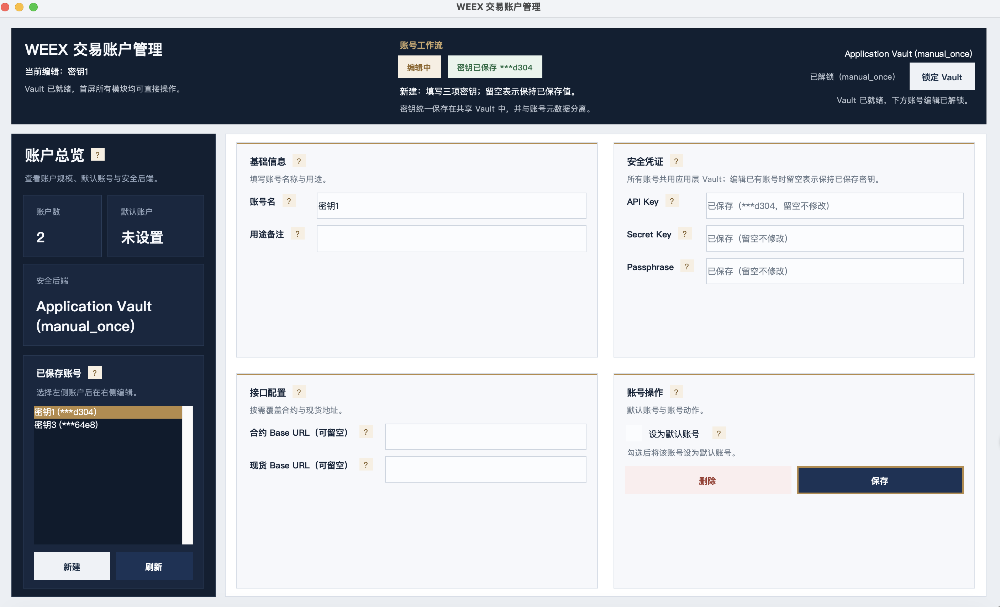

# WEEX Agent Skills 用户指南

[English](WEEX-Agent-Skills-User-Guide.md)

> 文档定位：面向首次使用 WEEX Agent Skills 的用户，介绍安装、账户配置、功能选择、交易确认和安全注意事项。
>
> 适用范围：WEEX Agent Skills 当前发布版本，包含 `$weex-trader-skill`、`$weex-analysis-skill`、`$weex-monitor-skill` 和 `$weex-partner-skill`。
>
> 功能依据：[WEEX Agent Skills 官方仓库](https://github.com/weex-labs/weex-agent-skills) `main` 分支；本次核验提交为 `1bb9b95643ae8c914f5f7294ea7c989c0c803495`（2026-09-08）。
>
> 使用方式：大多数功能可通过自然语言发起。除故障排查和进阶维护外，用户无需直接运行 Python 脚本。

## 重要提示

1. **建议先完成只读查询，再使用交易功能。** 首次使用时，建议依次验证公开行情查询、账户访问、余额与仓位查询，确认运行正常后再考虑交易操作。
2. **请妥善保护凭证。** Secret Key、API Passphrase 和 Application Vault（应用保险库）密码应通过本地窗口或本地终端输入，请勿粘贴到聊天、公开日志或截图中。
3. **真实盘操作须经明确确认。** 下单、撤单、调整杠杆等操作会影响真实资产。请在 AI 工具展示确认信息后逐项核对，并仅在内容准确时回复指定确认词。

风险声明：本指南仅介绍产品功能与操作流程，不构成任何投资或交易建议，也不对交易结果或收益作出承诺。

## 1. 产品概述

Skill 是安装到 AI 工具中的能力扩展。安装 WEEX Agent Skills 后，AI 工具可按照项目规定的权限、确认和安全流程，完成 WEEX 数据查询、交易数据分析、监控任务管理及 WEEX Partner 数据查询。

本项目包含四个 Skill：

| Skill | 职责 | 主要用途 |
| --- | --- | --- |
| `$weex-trader-skill` | WEEX REST 访问与交易执行 | 查询行情、管理 saved profile（已保存账户配置）、查询余额和仓位、预览订单、下单及撤单 |
| `$weex-analysis-skill` | 只读数据分析 | 分析已有数据中的盈亏、手续费、风险与交易行为 |
| `$weex-monitor-skill` | 本地未实现盈亏监控编排 | 持续检查合约仓位的未实现盈亏，并在条件满足且获得授权后执行一次平仓 |
| `$weex-partner-skill` | WEEX Partner 只读查询编排 | 查询直客、返佣、子代理和直客资产等 WEEX Partner 数据 |

如无法确定应使用哪个 Skill，可描述具体目标，并要求 AI 工具选择正确的 Skill。例如：

```text
请为“查看 BTC 合约仓位”选择适用的 WEEX Skill。仅执行查询，不进行任何交易。
```

## 2. 使用前准备

### 2.1 支持 Skill 的 AI 工具

官方仓库为 Codex、Claude Code、Cursor、GitHub Copilot 和 OpenClaw 提供安装入口。前四个宿主使用常规安装方式；OpenClaw 使用固定的本地 Git 仓库和 Skill 目录软链接。

### 2.2 WEEX 账户要求

- **查询公开行情：** 不需要登录 WEEX，也不需要 API Key。
- **查看账户余额、订单或仓位：** 需要 WEEX 账户和已保存的 API 配置。
- **真实下单、撤单或修改账户设置：** 需要相应的 API 权限，并须经过用户明确确认；自动策略还须具备有效的自动交易授权。
- **分析已有的 JSON 数据文件：** 不需要连接 WEEX 账户。
- **查询 WEEX Partner 数据：** 当前账户需要具备相应的 WEEX Partner 权限。

API（应用程序接口）用于在软件与 WEEX 之间传递请求。用户无需了解其技术实现，但须安全保存 WEEX 提供的三项凭证。

## 3. 安装 WEEX Agent Skills

### 3.1 推荐方式：通过 AI 工具安装

在 AI 工具中发送：

```text
请从 https://github.com/weex-labs/weex-agent-skills 安装全部 WEEX Agent Skills，并将它们安装到当前工具的 Skill 目录中。
```

安装完成后，请发送：

```text
请检查 $weex-trader-skill、$weex-analysis-skill、$weex-monitor-skill 和 $weex-partner-skill 是否均可使用。请勿连接我的账户或执行任何交易。
```

如 AI 工具提示需要重启或重新打开应用，请完成相应操作后再次检查。

### 3.2 手动安装（可选）

熟悉终端的用户可以运行：

```bash
npx skills add https://github.com/weex-labs/weex-agent-skills --all
```

不熟悉终端的用户可跳过本节，使用上一节的自然语言安装方式。

`$weex-monitor-skill` 和 `$weex-partner-skill` 均依赖 `$weex-trader-skill`。普通使用建议安装全部四个 Skill。

### 3.3 从本地 checkout 安装（可选）

如果已经下载或 clone 官方仓库，可在仓库根目录使用本地安装器：

```bash
python3 tools/install_local_skills.py --all --agent codex
```

Windows 用户可将 `python3` 替换为 `py -3`。其他宿主使用对应的 `--agent` 值：

| 宿主 | `--agent` 值 |
| --- | --- |
| Codex | `codex` |
| Claude Code | `claude-code` |
| Cursor | `cursor` |
| GitHub Copilot | `github-copilot` |

本地安装器会校验当前 `gh skill install` 是否支持所选宿主。单独安装 `$weex-monitor-skill` 或 `$weex-partner-skill` 时，安装器会自动带上其依赖的 `$weex-trader-skill`。

### 3.4 OpenClaw 用户

OpenClaw 使用固定的本地 Git 仓库和 Skill 目录链接，不使用上述 `npx` 安装方式。请在已获取的项目目录中运行：

```bash
bash skills/weex-trader-skill/scripts/update_openclaw_skills.sh
```

生产更新会取得官方批准的固定 release commit `e10c2089550159afb7247271d1041d9b415145cd`，不会跟随可变分支。更新脚本会在临时目录验证 Git 对象、四个 Skill 和 submodule 状态，再切换软链接并执行 OpenClaw 可用性检查。任一步骤失败时，脚本会恢复原 checkout 和原软链接。

后续常规更新可运行：

```bash
~/bin/update-weex-openclaw-skills.sh
```

如果目标位置已经存在真实文件或目录，脚本会停止且不会覆盖用户数据。需要恢复稳定版本时，可重新运行：

```bash
bash ~/.openclaw/update-weex-openclaw-skills.sh
```

更新后可执行以下 OpenClaw 检查：

```bash
openclaw skills list --eligible
openclaw skills info weex-trader-skill
openclaw skills check
```

完成后，可使用以下请求进行只读验证：

```text
使用 $weex-trader-skill 查询 BTCUSDT 最新现货价格，仅查询公开行情。
```

## 4. 首次使用：验证公开行情查询

建议先在不连接账户的情况下使用以下请求：

```text
使用 $weex-trader-skill 查询 BTCUSDT 最新现货价格。
```

```text
使用 $weex-trader-skill 查看 BTCUSDT 合约最近 24 小时的价格变化。
```

```text
使用 $weex-trader-skill 查询 BTCUSDT 当前资金费率，并使用简明语言说明结果。
```

以上请求均为公开查询，不读取私有账户数据，也不会创建订单。

## 5. 配置 WEEX 账户访问

查看私有账户数据或执行交易前，须完成本节配置。

每次使用 `$weex-trader-skill` 时，AI 工具都会先刷新运行前检查状态。执行任何私有 profile、Application Vault 或交易操作前，如依赖缺失、运行环境配置无效或环境检查未通过，工具将停止操作并说明修复方式。该检查不会隐式安装 GUI 运行环境。

### 5.1 创建 WEEX API 凭证

请在 WEEX 的 [API 管理页面](https://www.weex.com/account/newapi/) 创建 API 凭证。创建完成后将获得：

- **API Key：** 用于标识一组 API 权限。
- **Secret Key：** 用于请求签名，须严格保密。
- **API Passphrase：** 创建 API 时设置的配套口令，须严格保密。

建议遵循最小权限原则创建 API。仅需查询时，请勿授予交易权限。如凭证可能泄露，应立即在 WEEX 撤销或轮换凭证。

### 5.2 saved profile 与 Application Vault

- **saved profile（已保存账户配置，以下简称 profile）：** 为一组 WEEX API 配置指定本地名称，例如“主账户”或“只读账户”。创建 profile 不会创建新的 WEEX 账户。
- **Application Vault（应用保险库）：** 用于在本机加密保存 API 凭证。

完成配置后，可在后续请求中直接指定 profile 名称，无需重复输入凭证。

一个完整 profile 包含以下字段：

| 字段 | 是否必填 | 说明 |
| --- | --- | --- |
| profile 名称 | 是 | 后续选择账户时显示和使用的名称 |
| API Key | 是 | WEEX API Key |
| Secret Key | 是 | 用于私有请求签名的 WEEX Secret Key |
| API Passphrase | 是 | 与 API Key、Secret Key 配套的 WEEX API Passphrase |
| 说明/备注 | 否 | 记录账户用途或权限范围 |
| 合约 API 地址 | 否 | 留空时使用 `https://api-contract.weex.com` |
| 现货 API 地址 | 否 | 留空时使用 `https://api-spot.weex.com` |
| 默认 profile | 否 | 设置后，未明确指定 profile 的私有请求可以使用该配置 |

自定义 API 地址必须是完整的 HTTPS URL，且域名属于 `weex.com`、其子域、`weex.tech` 或其子域。没有明确的测试环境需求时，应保持为空并使用官方默认地址。

### 5.3 Windows 或 macOS

建议通过 AI 工具打开本地 Profile Manager（账户配置管理器）：

```text
使用 $weex-trader-skill 打开中文 Profile Manager，并在本机创建一个 saved profile。请采用本地凭证输入方式，请勿要求我将密钥粘贴到聊天中。
```



*图 1：中文 Profile Manager。界面集中展示 saved profile、Application Vault、凭证状态、API 地址和账户操作。截图中的凭证均为掩码显示。*

Windows 和 macOS 的 GUI 必须使用项目管理的 CPython 3.12.13 GUI 运行环境，不能使用系统、Homebrew、Miniforge 或 pyenv Python 代替。首次打开时，AI 工具会说明固定版本、安装包校验和依赖哈希，并在获得明确同意后安装；该环境不会被隐式安装。如不安装，可使用终端配置方式。

在本地窗口中：

1. 初始化或解锁 Application Vault。
2. 填写 profile 名称。
3. 在本地输入 API Key、Secret Key 和 API Passphrase。
4. 可选填写说明，例如“主账户”或“只读账户”。
5. 合约与现货 API 地址通常保持为空；留空时使用 WEEX 官方地址。
6. 如仅配置一个 profile，可将其设置为默认 profile。
7. 保存后，请通过只读查询验证配置。

### 5.4 Linux

Linux 桌面环境或交互式终端建议使用中文配置向导：

```text
使用 $weex-trader-skill 在 Linux 上启动中文账户配置向导。请说明每个步骤，并使用本地方式输入凭证。
```

Linux 使用 `manual_once` Application Vault 模式。系统重启或会话重置后通常需要重新解锁。该模式通过增加显式解锁步骤，减少凭证持续处于可用状态的时间。

创建 Application Vault 或更换 Vault 密码时，新密码必须由用户明确选择并连续确认两次；解锁已有 Vault 时仅验证一次现有密码。AI 工具不得推断、生成或替换 Vault 密码。只有用户明确要求覆盖现有 Vault 配置时，才能使用强制重置。

### 5.5 多 profile 选择

如存在多个可用 profile，AI 工具应仅显示 profile 名称，并要求用户回复序号或准确名称。例如：

```text
1. 主账户
2. 量化账户
3. 备用账户
```

AI 工具不得根据名称相似度、列表顺序或备注自行选择。完成选择后，同一对话可继续使用该 profile，直至用户明确更换或选择再次产生歧义。

### 5.6 profile 与 Application Vault 管理能力

- 新建、查看和列出 profile
- 修改 profile 名称或说明
- 更换 API Key、Secret Key 和 API Passphrase
- 设置或取消默认 profile
- 删除本地 profile
- 初始化、查看状态、解锁和锁定 Application Vault
- 更换 Application Vault 密码

删除 profile、重置 Application Vault 或轮换凭证前，请确认目标及影响范围。仅在明确需要覆盖现有 Vault 配置时使用强制重置。

### 5.7 本地凭证输入方式

交互式使用时，优先通过 Profile Manager、Application Vault 窗口或终端安全提示输入凭证。服务器或自动化环境可使用环境变量，或通过标准输入传递凭证 JSON。请勿将 API Key、Secret Key、API Passphrase 或 Vault 密码直接写入命令参数；命令参数可能出现在进程列表、终端历史或日志中。

进阶终端方式包括 `--prompt-secrets`、凭证环境变量参数和 `--secrets-stdin-json`。Linux 的一次性非交互 Vault 操作可使用临时密码文件；临时文件应保存在仓库外并在操作后立即删除。

## 6. 操作类型与影响范围

| 类型 | 是否读取私有账户 | 是否影响资产 | 示例 |
| --- | --- | --- | --- |
| 公开查询 | 否 | 否 | 查询价格、K 线、资金费率 |
| 私有只读查询 | 是 | 否 | 查询余额、仓位、订单历史 |
| 本地操作 | 可能读取本地配置 | 通常不会直接影响 WEEX | 保存 profile、创建监控草稿 |
| 模拟盘操作 | 是 | 影响 WEEX 模拟盘数据 | 模拟合约下单 |
| 真实盘操作 | 是 | 是 | 真实下单、撤单、调整杠杆 |

注意：**模拟盘操作不是本地 dry-run。** 模拟合约下单会向 WEEX 模拟盘提交请求，但不使用真实资产。

## 7. `$weex-trader-skill`：WEEX 访问、账户管理与交易

该 Skill 负责 WEEX REST 访问、profile 与 Application Vault 管理，以及所有实时订单操作。其他 Skill 如需实时账户数据或执行订单，也由该 Skill 提供相应能力。

### 7.1 公开行情功能

以下功能无需连接 WEEX 账户：

| 类别 | 可查询内容 |
| --- | --- |
| 基础信息 | 服务器时间、支持的币种和交易对、现货或合约产品规则 |
| 价格 | 最新价、24 小时变化、最佳买价和卖价 |
| 市场深度 | 买卖盘挂单数据（订单簿） |
| 成交与走势 | 最近成交、K 线、历史 K 线 |
| 合约专属 | 当前和历史资金费率、指数价格、标记价格、持仓总量 |
| 连接检查 | 检查公开接口是否可访问 |

示例：

```text
使用 $weex-trader-skill 查询 ETHUSDT 现货最新价、24 小时涨跌和最佳买卖价，用表格展示。
```

```text
使用 $weex-trader-skill 查询 BTCUSDT 合约的当前资金费率、标记价格和持仓总量，并使用简明语言说明结果。
```

### 7.2 私有账户只读查询

以下功能需要可用的 saved profile，且均为只读查询，不创建订单：

| 市场 | 可查询内容 |
| --- | --- |
| 合约 | 余额、账户设置、单个或全部仓位、手续费率、账单、交易对设置 |
| 现货 | 资产余额、账户交易状态、手续费、现货账单、资金账户账单、划转记录、现货交易记录 |
| 订单 | 当前订单、历史订单、单笔订单详情、成交详情、条件单和止盈止损单状态 |

合约私有查询须明确选择**真实盘**或**模拟盘**。profile 名称不能代替交易环境选择。当前版本的模拟盘能力仅适用于合约，不适用于现货。

所有使用私有 WEEX 数据或提及私有订单操作的自然语言结果，首行都应显示当前交易环境，例如 `当前交易环境：真实盘` 或 `当前交易环境：模拟盘`。该首行用于说明数据和操作所属环境，本身不构成订单确认。

示例：

```text
使用 $weex-trader-skill 和“主账户”profile 查看真实盘合约余额及全部仓位。仅查询，不下单。
```

```text
使用 $weex-trader-skill 查看“主账户”profile 的真实盘 BTCUSDT 当前订单和最近成交。仅执行只读查询。
```

```text
使用 $weex-trader-skill 查看“演练账户”profile 的模拟盘合约余额、全部仓位和历史订单。
```

模拟盘当前支持合约余额、全部仓位、历史订单和下单。对于模拟盘暂无对应接口的数据，例如成交、账单、当前条件单或止盈止损状态，工具将明确标识数据不完整，且不会使用真实盘数据替代。

### 7.3 交易历史采集

`$weex-trader-skill` 可以将实时或历史数据整理为标准化格式，再交由 `$weex-analysis-skill` 处理：

- 采集一段时间的订单和成交，用于交易复盘
- 采集用于生成交易画像的数据
- 采集一笔订单的风险资料
- 采集当前账户风险资料

示例：

```text
使用 $weex-trader-skill 从“主账户”profile 采集真实盘最近 30 天的 BTCUSDT 合约复盘数据，保存为 JSON。仅采集数据，不执行交易。
```

JSON 是一种结构化文本格式。用户无需直接编辑文件内容，可将文件交由 `$weex-analysis-skill` 处理。

### 7.4 风险预览与账户风险检查

支持：

- 下单前预览风险
- 创建止盈止损条件单前预览风险
- 无待下订单时，单独检查当前账户风险
- 提醒可用余额、仓位集中、杠杆、止盈止损缺失等问题

风险预览用于提供操作前提醒，不构成投资建议，也不能替代用户的独立判断。

```text
使用 $weex-trader-skill 检查“主账户”profile 的真实盘合约账户风险。仅执行检查，不生成订单。
```

### 7.5 下单、撤单和账户设置

`$weex-trader-skill` 支持以下会改变账户状态的功能：

| 类别 | 功能 |
| --- | --- |
| 合约订单 | 单笔或批量下单、撤销单笔/批量/全部订单、按方向平仓 |
| 合约条件单 | 创建和撤销条件单、创建/修改/撤销止盈止损单 |
| 现货订单 | 单笔或批量下单、撤销单笔/批量订单、按交易对撤销全部订单 |
| 合约设置 | 调整逐仓保证金、切换保证金模式、开关自动追加保证金、调整杠杆 |
| 订单跟踪 | 查询当前订单、历史订单、单笔状态和成交详情 |

`$weex-trader-skill` **不提供 WEEX Partner 转账或提现功能**。支持查询划转记录不代表支持创建资金划转。

### 7.6 标准下单流程

以真实盘合约订单为例：

1. 用户提供 profile、真实盘、交易对、方向、订单类型、数量和价格。
2. AI 工具读取最新账户和市场信息。
3. AI 工具展示风险预览和完整订单摘要。
4. 用户核对 profile、交易环境、方向、数量、价格、费用和主要提醒。
5. 仅当用户回复确认信息中显示的准确确认词后，工具才会提交订单。
6. 提交后查询订单是否已被 WEEX 接受或成交。

私有账户查询和直接交易请求必须明确选择真实盘或模拟盘。订单预览请求如已包含 profile 和订单信息但未写交易环境，AI 工具会先根据用户明确表述生成预览；没有可用依据时，初始预览使用真实盘。预览不会提交订单，用户仍可要求切换环境并重新生成预览。

示例：

```text
使用 $weex-trader-skill，为“主账户”profile 的真实盘预览一笔 BTCUSDT 合约限价多单：价格 60000 USDT，数量 0.001 BTC。仅生成预览，获得我的明确确认后再决定是否提交。
```

如市场或账户条件已经变化、预览已经过期，或订单内容被修改，须重新生成预览，不得继续使用旧确认。

执行时仅需回复预览结果要求的准确确认词。用于绑定最新预览的内部意图 ID 和风险签名由工具管理，用户无需复制或提供。旧预览、过期预览或与当前订单不一致的确认不得复用。

### 7.7 止盈止损与价格条件单

按价格触发的平仓，应使用 WEEX 官方条件单：

```text
使用 $weex-trader-skill，为“主账户”profile 的真实盘 BTCUSDT 多仓预览一个官方止损条件单，触发价格为 58000。暂不提交订单。
```

用户也可以明确指定“全部仓位”。此时通常无需另行提供数量：

```text
为 BTCUSDT 真实盘多仓的全部仓位预览止损条件单，触发价格为 58000。暂不提交订单。
```

价格阈值平仓请求应使用 WEEX 官方条件单，不应由 `$weex-monitor-skill` 创建本地价格监控，具体边界见第 9 章。

### 7.8 自动策略授权（进阶）

该功能仅适用于使用 saved profile 的真实盘自动交易，面向用户自行维护的 Python 或量化策略。建议具备相应技术能力后再启用。系统不自动识别或接入本机任意脚本，也不支持模拟盘。

支持以下操作：

- 注册、查看或永久停用一个策略身份
- 创建、查看、批准、列出或撤销自动交易授权
- 在授权范围内提交经过检查的现货或合约订单
- 查看每笔自动订单的本地记录和通知
- 查询 WEEX 的订单结果并核对本地记录
- 处理结果不确定的额度记录
- 备份和恢复本地授权状态
- 恢复后，在完成检查的前提下重新启用自动交易

每个策略首次接入时注册一个稳定策略 ID；重启或改名后继续使用同一 ID，复制策略则注册新的 ID，并拥有独立授权和额度。永久停用策略身份后，该身份不能再次申请授权。

每项授权须明确以下范围：

1. 允许现货、合约，或同时允许两者。
2. 允许指定交易对，或允许全部交易对。
3. 每个订单项的保守 U 估算上限。
4. 整个授权有效期内的累计保守 U 估算上限。
5. 授权有效期；有效期必须大于 0，且最长为 720 小时（30 天）。

授权范围不额外限制买卖方向、订单类型、最小下单金额或订单次数。如自然语言请求未说明累计额度，AI 工具必须单独询问，不得根据交易频率、有效期、目标金额、单项上限、账户余额或预计订单数自行推算。最终确认中的累计额度必须与用户输入一致。

“保守 U 估算额度”由工具根据最新官方数据计算，不一定等于实际成交金额。已被 WEEX 接受的订单会在当前授权期内持续占用相应额度，后续对账不自动返还该额度。

批准授权本身不提交订单。但在授权有效期内，符合授权范围且通过检查的订单可以不再逐笔确认。撤销或到期仅阻止后续自动订单，不撤销已经提交的订单。

批量订单在提交前进行整组检查和额度预占。订单被 WEEX 明确接受后，保守估算额度在当前授权期内持续占用；WEEX 明确拒绝时释放对应预占额度；结果或订单映射不确定时标记为 `REVIEW_REQUIRED` 并转人工核查。系统不会拆分、猜测映射或自动重试该批次。

待确认的授权申请不具备交易权限，并在 15 分钟后失效。授权有效期从批准成功时开始计算；修改任何授权范围均须重新申请并获得明确批准，新授权生效后将替换原有活动授权。

旧版本中包含已移除扩展范围字段的授权仍可审计，但不能继续自动提交订单；工具会要求用户按照当前五个授权维度重新申请并批准授权。

批准前的完整确认应显示：saved profile 全名、脱敏策略 ID、现货/合约模块、交易对范围、单项保守 U 估算上限、累计额度、预计有效期、是否免除逐笔确认、撤销方式和本地信任边界。真实盘自动任务只有在同一次更新中同时设置活动状态和不晚于授权到期时间的结束时间后才能运行，不允许启用无到期时间的循环任务。

自动路径只接受官方现货或合约操作，并要求官方市场、产品、余额和风险数据新鲜且完整。数据缺失、陈旧、降级，或遇到范围超限、额度超限、授权撤销/到期、状态冲突及未知操作时，不会自动向 WEEX 写入，而是回到人工预览与确认流程。现货订单还会校验官方数量规则和对应资产余额。

全部仓位止盈止损因无法在自动路径中确定固定数量，始终返回人工确认；部分只减仓请求也必须取得官方证据后才能进入自动路径。

普通成功事件可以按 60 秒窗口汇总通知，异常事件立即通知。通知仅尝试一次，通知失败不会改变订单、授权或额度状态。

本地授权状态支持备份和恢复。快照默认保留 10 份，可设置为 1 至 100 份；恢复时只接受 Trader 生成的快照 ID，不接受任意文件路径。任何格式有效的恢复尝试都会先关闭自动交易。恢复完成后必须重新授权、处理全部未确定记录，并明确重新启用自动交易。

快照和授权数据库仅依赖当前操作系统用户的文件权限，不提供额外的密码加密，也不自动上传或跨设备同步。这些权限和完整性检查用于降低误操作与文件损坏风险，不构成身份认证，也不能防御已经控制同一操作系统用户、Agent、Vault 会话或 API Key 的攻击者。

自动策略授权当前在 Windows 上不可用；常规 profile 管理、行情查询和手动确认交易不受该限制。

### 7.9 进阶与维护入口

`$weex-trader-skill` 还提供以下辅助能力：

- 列出当前版本支持的现货或合约接口
- 按项目内的官方接口目录发起结构化查询
- 在短时间内重复查询最新价格
- 检查 Python、网络设置、账户配置和图形窗口环境是否就绪
- 修复缺少的运行组件
- 供项目维护者更新本地接口目录

以上入口主要用于故障排查、开发维护或补充少见查询。一般使用场景建议优先通过自然语言说明目标，无需直接调用底层接口。任何会改变真实账户状态的底层请求仍须经过明确确认。

当前 Skill 主要通过 REST 方式访问 WEEX；项目中的 WebSocket 页面为补充参考，不表示本指南所述的常规自然语言流程会自动建立长期数据连接。

## 8. `$weex-analysis-skill`：WEEX 数据只读分析

该 Skill 仅分析输入数据，不直接连接私有账户，不下单、不撤单，也不会修改本地 profile 或 Application Vault 状态。

### 8.1 八类分析功能

| 功能 | 功能说明 | 示例请求 |
| --- | --- | --- |
| 账户快照分析 | 评估当前仓位集中度、杠杆水平和可用资金情况 | `分析这个账户快照，请按严重程度列出三个主要风险。` |
| 成交分析 | 汇总买卖成交、已实现盈亏和手续费 | `分析这些成交记录，算出扣除手续费后的已实现盈亏。` |
| 大文件整理 | 按交易对、账户范围或时间筛选较大的复盘文件 | `先整理这份大复盘文件，只保留 BTCUSDT 和最近 30 天。` |
| 行为复盘 | 识别频繁交易、追涨杀跌、持仓时间差异等行为模式 | `复盘这些交易，请列出三个主要交易行为模式及相应依据。` |
| 逐笔交易回顾 | 将开仓、加仓、减仓和平仓整理为独立交易过程 | `按交易过程回顾这些记录，并标出关键交易过程。` |
| 交易画像 | 根据足够的历史样本，总结交易风格、优点和弱点 | `根据这份复盘数据生成交易画像。` |
| 下单前风险分析 | 解释 `$weex-trader-skill` 生成的订单风险资料 | `分析这份订单风险 JSON，列出确认前要看的提醒。` |
| 当前账户风险分析 | 不依赖待下订单，分析当前账户整体风险 | `分析这份账户风险 JSON，按严重程度排序。` |

### 8.2 从实时账户到分析结果

实时账户数据须先由 `$weex-trader-skill` 采集：

```text
先使用 $weex-trader-skill 从“主账户”profile 的真实盘采集最近 30 天 BTCUSDT 合约复盘数据；再使用 $weex-analysis-skill 分析交易行为和手续费。全程仅执行只读操作。
```

AI 工具应先将数据整理为目标分析功能接受的标准化 JSON，再交由 `$weex-analysis-skill` 处理。仅提供概括性文字可能导致关键字段缺失并降低分析完整性。

Trader 采集的数据如包含 `trading_mode`、`environment` 或 `account_scope`，Analysis 必须保留这些字段，并在面向用户的结果中使用“真实盘”或“模拟盘”显示交易环境。不得根据 profile 名称或交易对推断缺失的交易环境；如环境信息会影响解释，应先询问数据来源。

### 8.3 结果说明

- 数据缺少价格、杠杆或余额时，结果可能仅覆盖部分分析项。AI 工具应明确说明缺失字段，不得推断。
- 交易画像描述的是过去的样本，不能预测市场方向。
- 样本数量不足时，仅提供基础观察，不形成强结论。
- 所有分析都只供参考，不构成投资或交易建议。

每一份面向用户的分析结果都必须原样包含以下标准免责声明，不得改写、缩短或省略：

```text
Disclaimer: This result is generated solely from the current input data and is for reference only. It does not constitute any investment or trading advice. Please make your own independent judgment based on real-time data, official rules, and your own risk tolerance. Responsibility for related decisions and execution rests solely with the user.
```

## 9. `$weex-monitor-skill`：合约仓位未实现盈亏监控

`$weex-monitor-skill` 负责创建、确认、保存、检查和管理本地监控任务。WEEX 仓位读取和获授权后的平仓操作仍由 `$weex-trader-skill` 完成。

### 9.1 支持的两类监控

| 类型 | 监控内容 | 触发动作 |
| --- | --- | --- |
| `position_pnl_monitor`（仓位未实现盈亏监控） | WEEX 返回的指定交易对和持仓方向的未实现盈亏 | 对同一持仓方向执行一次市价平仓 |
| `order_baseline_pnl_monitor`（订单基准未实现盈亏监控） | 根据已知成交价、成交数量和当前价格在本地估算订单基准未实现盈亏 | 按该订单的固定数量执行一次市价平仓 |

“未实现盈亏”是仓位尚未平仓时随价格变化的浮动盈利或亏损。

订单基准未实现盈亏是本地估算值，不是 WEEX 提供的“单笔订单独立盈亏”。WEEX 仓位通常按“交易对 + 持仓方向”汇总，因此确认时仍须核对该方向的总仓位。

### 9.2 请求信息要求

请求应包含：

- saved profile 名称
- 真实盘或模拟盘
- 合约交易对，例如 BTCUSDT
- 多仓或空仓
- 触发条件，包括比较关系和数值阈值，例如“未实现盈利大于 50 USDT”
- 触发动作；当前仅支持对同一持仓方向执行市价平仓
- 仓位未实现盈亏监控可以指定平仓数量；未指定数量时，使用触发前重新核对的匹配仓位数量
- 订单基准未实现盈亏监控必须提供大于 0 的基准成交价和基准数量，平仓数量必须等于对应基准订单数量
- 如要求立即启动，须指定有限运行时间，例如 1 小时
- 可选：检查频率；未指定时默认为 5 秒一次，且不得低于 3 秒
- 可选：状态回报频率；未指定时默认为 60 秒一次，且不得低于 60 秒，并按整分钟设置

示例：

```text
使用 $weex-monitor-skill，为“主账户”profile 的真实盘 BTCUSDT 多仓创建并启动未实现盈亏监控：未实现盈利大于 50 USDT 时市价平多，运行 1 小时。请先读取并展示匹配的真实盘仓位，获得我的明确确认后再启动。
```

订单基准示例：

```text
使用 $weex-monitor-skill 监控“主账户”profile 真实盘的一笔 BTCUSDT 多单：成交价 60000，数量 0.001 BTC；当本地估算的未实现盈利大于 10 USDT 时，按 0.001 BTC 市价平多，运行 30 分钟。请先展示当前总仓位和完整确认信息。
```

### 9.3 确认信息

启动真实盘或模拟盘监控前，AI 工具应展示：

- 当前交易环境；中文确认信息及监控结果报告须以 `当前交易环境：真实盘` 或 `当前交易环境：模拟盘` 开头
- 匹配到的交易对、持仓方向和仓位数量
- 开仓价、当前价或标记价、杠杆、保证金模式、可平仓数量、强平价格、仓位更新时间等仓位字段
- 账户可用余额、交易环境和确认快照时间
- 仓位监控的总未实现盈亏；指定固定监控/平仓数量时，还须显示按数量折算的未实现盈亏
- 订单基准监控的基准成交价、基准数量、当前价格、本地订单基准未实现盈亏估算和当前方向总仓位，并明确提示该估算不是交易所原生的单笔订单独立盈亏
- 触发条件、平仓方向和数量
- 检查频率、有限运行时间和状态回报频率
- 一次性触发说明：成功处理后不会重复执行平仓

如果 WEEX 未返回某个确认字段，结果应明确显示“未返回”，不得使用推测值补齐。

缺少必要字段、找不到匹配仓位、仓位数量为 0、输入数据状态未知，或持仓方向存在歧义时，任务不可执行。AI 工具应保留草稿或报告触发情况，并要求补充信息或人工处理，不得推断方向后提交订单。

用户须核对全部信息，并仅回复确认内容要求的准确确认词。监控确认及订单执行授权必须与所显示的真实盘或模拟盘一致。

### 9.4 任务管理能力

- 预览监控草稿但不启动任务
- 确认并保存任务
- 列出本地监控任务
- 查看任务事件记录
- 使用本地样例数据做演练
- 对真实盘或模拟盘账户执行单次检查
- 在有限时间内循环检查
- 取消尚未完成的本地任务
- 在支持的 AI 工具中定期回报状态

dry-run 模式仍会写入本地任务和事件记录，以便审计触发处理过程，但不会向 WEEX 提交订单。

监控结果与状态回报仅发送到创建任务的当前对话。状态回报只展示任务状态、条件、当前值、阈值、触发状态、原因和经过处理的订单或错误摘要，不展示原始交易所响应、完整订单 JSON 或完整账户快照。

支持周期状态回报的宿主会使用各自的原生能力：Codex 使用任务 heartbeat，Claude Code 使用 `/loop`，OpenClaw 使用 cron。创建状态回报前应检查是否已经存在同一任务，避免重复；如果当前宿主不提供相应能力，监控任务仍可继续运行，但不会自动发送周期状态。

取消操作只取消本地监控任务，不撤销、修改或重试已经提交到 WEEX 的订单，也不会自动处理现有仓位。任务达到 `completed`、`cancelled` 或 `review_required` 等终态后，配套的周期状态回报应停止。

如委托执行失败，任务会进入 `review_required`（需要人工查看）并记录事件，不会静默重试。请先检查任务事件和执行结果，不得直接重复启动，以避免重复平仓。

### 9.5 能力边界

`$weex-monitor-skill` 不用于：

- 按 BTC 价格达到某个数字触发
- 开仓、加仓、反手或修改杠杆
- 现货交易
- 网格、移动止损或任意脚本
- 一个任务同时处理多个账户

如果需求是“BTC 到 65000 时平仓”，请使用 `$weex-trader-skill` 创建 WEEX 官方条件单：

```text
使用 $weex-trader-skill 为 BTCUSDT 仓位预览 WEEX 官方价格条件平仓单。暂不提交订单。
```

## 10. `$weex-partner-skill`：WEEX Partner 只读查询

该 Skill 适用于具备 WEEX Partner 权限的用户。它复用 `$weex-trader-skill` 管理的 saved profile 与 Application Vault，仅执行只读查询，不转账、不提现、不下单。

查询前，AI 工具会执行 Partner 专用安全检查，只显示所选 profile 的非秘密身份信息、运行状态和 `partner_production` 或 `partner_test` 环境标签，不显示具体测试地址、API Key 提示或其他不相关的 profile 路由信息。

### 10.1 七类查询功能

| 功能 | 返回内容 | 示例 |
| --- | --- | --- |
| 直客 UID 列表 | 查询一个直客或已明确确认范围内的直客 UID | `查询最近默认时间范围内的直客 UID 列表。` |
| 直客交易与资金统计 | 入金、出金、现货/合约交易量、返佣等综合统计 | `查询 UID 123456 的交易与资金统计。` |
| 返佣记录 | 查询返佣记录，可按允许的币种和产品筛选 | `查询 UID 123456 最近 7 天的返佣。` |
| 子代理统计 | 子代理的交易量、手续费和返佣 | `查询子代理 UID 123456 的合约统计，时间为……` |
| 直客关系验证 | 判断一个或多个 UID 是否为当前 WEEX Partner 的直接推荐用户 | `验证 UID 123456 是否是我的直客。` |
| 直客资产 | 查询一个直客在指定日期范围内的资产资料 | `查询 UID 123456 从 2026-08-01 到 2026-08-31 的直客资产。` |
| 直客成交统计 | 查询下级用户的现货或合约成交统计，不包含入金、出金和返佣 | `查询 UID 123456 在指定日期内的合约成交统计。` |

UID 是 WEEX 用户编号。

UID 必须是大于 0 的十进制整数，且不超过有符号 64 位整数范围。请勿使用带逗号的数字、嵌套列表或其他格式。直客关系验证一次可处理多个 UID；超过 100 个时，工具会自动拆分为互不重叠的批次。

不同查询的必要信息如下：

| 查询类型 | 必要信息或默认规则 |
| --- | --- |
| 直客 UID 列表 | 指定 UID，或明确确认全部直客范围；未指定时间时使用官方 90 天默认区间 |
| 直客交易与资金统计 | 指定 UID，或明确确认全部直客范围；未指定时间时使用官方 90 天默认区间 |
| 返佣记录 | 指定 UID，或明确确认全部直客范围；未指定时间时使用官方 7 天默认区间，产品类型默认现货 |
| 子代理统计 | 指定子代理 UID 或明确确认全部范围，并提供产品类型；生产环境还须提供时间范围。仅已验证的 `partner_test` 环境可省略时间并使用上游默认值，此时不得声称覆盖了确定时间范围 |
| 直客关系验证 | 提供一个或多个 UID；每个 UID 仅验证是否为当前 WEEX Partner 的直接推荐用户 |
| 直客资产 | 提供一个 UID 及明确的开始、结束日期 |
| 直客成交统计 | 提供一个或多个 UID，或明确确认全部范围，并提供明确日期 |

### 10.2 查询时的重要规则

- 未提供 UID 时，系统不会自动查询所有直客。用户须明确提出“查询全部直客”并确认查询范围。
- “全部直客”仅表示确认查询范围，不表示自动获取全部明细。默认返回摘要和前 20 条记录；如需完整列表或汇总结果，须明确提出。
- 未指定时间时，仅在官方规则允许的情况下使用最小默认时间范围。结果将显示实际 UTC 开始和结束时间。
- 中文结果中的毫秒时间显示为 `YYYY-MM-DD HH:mm:ss（UTC）`，只有日期的官方字段显示为 `YYYY-MM-DD（UTC）`；工具不会为只有日期的数据补造具体时刻。
- 部分查询必须提供产品类型、UID 或开始/结束日期。AI 工具应仅询问仍然缺失的必要信息。
- 返佣币种筛选只接受该功能支持的币种；当前为 USDT 或 BTC。
- 用户明确查询超过三个自然月的返佣记录时，系统先查询最近三个自然月，再提供严格衔接且不重叠的“继续查询更早时间”操作，直至达到用户原始开始时间。上游拒绝任何区间时立即停止，不推断无限历史范围。
- 数据量较大时，AI 工具会提供“继续下一页”或“继续更早时间”的选项。继续前须阅读有关数据变化或重复覆盖的提示。
- 继续查询时必须原样复用上一次结果返回的 continuation 和其中一个准确操作，不得根据对话记忆重建或修改 profile、范围、筛选条件、结果模式、契约版本和实际时间范围。重复使用同一 continuation 可能重复或覆盖相同页/时间段的结果。
- 偏移分页没有固定快照，翻页期间数据可能变化。分页中断后，如需完整结果，必须从第 1 页重新开始，不能把中断前后的页面直接拼接为完整结果。
- 遇到请求次数限制（亦称“限流”）、超时或数据范围不完整时，工具会停止，且不自动重试。
- 查询结果为空仅表示当前范围未返回记录，不表示相关用户从未交易或从未入金。
- 结果应先说明 profile、查询范围和实际 UTC 时间，再说明数据完整或部分覆盖状态、摘要、默认最多 20 条记录、继续方式、全部警告和安全恢复建议。部分数据不得标记为完整总计。
- WEEX Partner 查询默认使用生产环境；已保存的严格 HTTPS `https://*.weex.tech` 测试子域可标记为 `partner_test`。结果只显示 `partner_production` 或 `partner_test` 环境标签，不显示具体测试地址，也不接受 API 地址环境变量覆盖或带鉴权的重定向。
- 已知业务字段必须使用官方中文或英文说明，并保留原始字段名。未在官方文档中定义的响应字段只显示字段名或隐藏数量，不显示其值，也不得根据字段拼写猜测含义。
- 关系验证结果 `is_referral=false` 仅表示该 UID 不是当前 WEEX Partner 的直接推荐用户，不表示账户不存在，也不能据此判断其属于其他 Partner。
- `$weex-partner-skill` 自身不持久保存 Partner 业务响应，但 AI 工具的聊天记录或工具记录仍可能保留查询输入和输出。指南不得承诺由 Skill 自动保存、访问或删除宿主记录。

### 10.3 不支持的 WEEX Partner 请求

- 创建转账、提现或其他 WEEX Partner 写操作
- 用 UID 查询手机号或邮箱
- 查询其他合伙人权限范围内的数据
- 把模糊的“交易统计”擅自解释为资金统计或成交统计

如“交易统计”的含义不明确，AI 工具须先确认用户需要入金、出金或返佣等资金统计，还是仅需要成交量统计。

## 11. 常用自然语言请求示例

### 11.1 查询公开行情

```text
使用 $weex-trader-skill 查询 BTCUSDT 现货最新价、24 小时涨跌和最佳买卖价。执行公开查询，不连接账户。
```

### 11.2 查看真实盘仓位

```text
使用 $weex-trader-skill 和“主账户”profile 查看真实盘 BTCUSDT 合约多仓与空仓、可用余额和未实现盈亏。仅执行只读查询，不进行任何交易。
```

### 11.3 查看模拟盘

```text
使用 $weex-trader-skill 和“演练账户”profile 查看模拟盘全部合约仓位与历史订单，仅执行只读查询。
```

### 11.4 采集并分析最近交易

```text
先使用 $weex-trader-skill 从“主账户”profile 的真实盘采集最近 30 天 BTCUSDT 合约复盘数据，再使用 $weex-analysis-skill 分析净盈亏、手续费、持仓时间和主要交易行为。全程仅执行只读操作。
```

### 11.5 预览现货订单

```text
使用 $weex-trader-skill，为“主账户”profile 的真实盘预览一笔使用 200 USDT 市价买入 BTC 的现货订单。请展示资产检查、预计金额和风险提醒，暂不提交订单。
```

### 11.6 预览合约订单

```text
使用 $weex-trader-skill，为“主账户”profile 的真实盘预览一笔 ETHUSDT 限价空单。价格为 2500 USDT，数量为……。请先展示账户、方向、数量、价格和风险信息，暂不提交订单。
```

### 11.7 创建仓位未实现盈亏监控

```text
使用 $weex-monitor-skill，为“主账户”profile 的真实盘 BTCUSDT 多仓创建并启动监控：未实现盈亏小于 -30 USDT 时市价平多，运行 2 小时。请先显示匹配仓位和完整确认内容。
```

### 11.8 查询 WEEX Partner 返佣

```text
使用 $weex-partner-skill 和“合伙人主账户”profile 查询官方默认时间范围内的现货返佣，说明实际 UTC 时间范围、数据是否完整以及是否存在后续页。仅执行只读查询。
```

## 12. 自然语言请求编写建议

可按以下结构编写请求：

```text
Skill 名称 + saved profile 名称 + 真实盘/模拟盘 + 交易对或 UID + 目标操作 + 时间或触发条件 + 只读/仅预览/等待确认 + 期望的结果格式
```

例如：

```text
使用 $weex-trader-skill + 主账户 profile + 真实盘 + BTCUSDT + 查看最近 7 天订单 + 仅执行只读查询 + 使用表格展示。
```

实际请求无需保留加号。提供清晰、完整的信息可以减少补充确认，并降低误选 profile 或交易环境的风险。

## 13. 真实盘操作确认清单

在回复确认词前，逐项检查：

- [ ] saved profile 名称正确
- [ ] 显示的是“真实盘”还是“模拟盘”
- [ ] 现货或合约正确
- [ ] 交易对正确，例如 BTCUSDT
- [ ] 买入/卖出、开多/开空、平多/平空正确
- [ ] 市价或限价正确
- [ ] 数量和价格正确
- [ ] 止盈止损是全部仓位还是部分仓位
- [ ] 可用余额和主要风险提醒已阅读
- [ ] 没有把旧预览的确认用到新订单上

如任一项无法确认，请要求 AI 工具取消当前待确认意图并重新生成预览。

## 14. 故障排查

### 提示 Skill 未安装或不可用

请检查四个 Skill 是否已安装到当前 AI 工具的 Skill 目录。必要时重新安装并重启 AI 工具；发起请求时应使用 `$weex-trader-skill` 等完整名称。

### 公开行情可用，但账户余额查询失败

公开行情无需账户凭证，余额查询需要可用的 saved profile。请检查是否已创建 profile、Application Vault 是否解锁，以及是否选择了正确的 profile。

### 存在多个 profile，无法确定目标账户

请要求 AI 工具仅列出 profile 名称，并通过序号或准确名称完成选择。AI 工具不得自行推断目标账户。

### Profile Manager 无法打开

请让 AI 工具检查项目管理的 GUI 运行环境并说明修复方案。确认安装说明后再执行安装；如不使用 GUI 运行环境，可改用本地终端配置。

### 提示缺少 Python 组件

可向 AI 工具发送以下请求：

```text
请使用 $weex-trader-skill 的运行环境修复方式安装项目锁定的依赖，然后重新执行只读检查。请勿连接账户或执行交易。
```

### 私有命令运行前检查失败

如提示 `WEEX_API_TIMEOUT` 必须是正数，或 `WEEX_API_BASE`、`WEEX_CONTRACT_API_BASE`、`WEEX_SPOT_API_BASE` 地址无效，请修正或取消对应环境变量后重新执行运行前检查。API 地址必须是完整 HTTPS URL，且域名属于 `weex.com`、其子域、`weex.tech` 或其子域；检查未通过前，私有命令不会继续执行。

### Linux 提示 Application Vault 已锁定

请在本地解锁 Application Vault 后重试。Vault 密码由用户设置和提供，不得由 AI 工具推断或生成。敏感操作完成后，可根据需要主动锁定 Vault。

### 提示认证或签名错误

请检查是否选择了正确的 saved profile，API Key、Secret Key 与 API Passphrase 是否属于同一组凭证，凭证是否有效，以及权限是否满足当前操作要求。

### WEEX 拒绝订单

请检查余额、API 交易权限、交易对、数量、价格、最小下单要求和当前产品状态。在拒绝原因未明确前，请勿重复提交。

### 分析结果显示“不完整”

请检查输入文件是否缺少价格、余额、杠杆、订单或成交。必要时由 `$weex-trader-skill` 重新采集所需数据；`$weex-analysis-skill` 不推断输入中不存在的账户状态。

### 监控任务进入“需要人工查看”

请先列出任务事件，核实是否已提交平仓请求，以及 WEEX 是否返回明确结果。请勿直接重启同一任务，以避免重复操作。

### WEEX Partner 查询未返回记录

请确认 UID、产品类型和 UTC 时间范围。空结果仅表示当前查询范围未返回记录。

## 15. 术语说明

| 术语 | 说明 |
| --- | --- |
| Skill | 安装到 AI 工具中的能力说明与配套工具 |
| API | 软件与 WEEX 交换查询或操作请求的通道 |
| REST | 常见的 API 使用方式：发送一次请求，取得一次结果 |
| WebSocket | 让软件保持连接并持续接收数据的方式 |
| API Key | 用于标识一组 API 权限的凭证字段 |
| Secret Key | 用于请求签名的机密凭证字段 |
| API Passphrase | 创建 API 时设置的配套口令 |
| saved profile | 在本机保存的一组 WEEX API 配置及其名称 |
| Application Vault | 在本机加密保存 API 凭证的应用保险库 |
| 现货 | 直接买卖币种 |
| 合约 | 用保证金参与价格变化的交易产品，风险通常更高 |
| 量化策略 | 按预先写好的规则自动判断和发出交易请求的程序 |
| 真实盘 | 会影响真实账户和真实资产的环境 |
| 模拟盘 | WEEX 提供的演练环境，不使用真实资产 |
| dry-run | 使用本地输入验证流程但不向 WEEX 提交订单的演练方式 |
| 交易对 | 两种资产的组合，例如 BTCUSDT |
| 多仓 | 以价格上涨为预期方向的合约仓位 |
| 空仓 | 以价格下跌为预期方向的合约仓位 |
| 市价单 | 按当前市场可成交价格尽快执行的订单 |
| 限价单 | 只在指定价格或更优价格成交的订单 |
| 条件单 | 达到指定条件后才触发的订单 |
| 止盈 / 止损 | 达到盈利或亏损条件时触发的处理方式 |
| 杠杆 | 用较少保证金控制较大仓位的倍数；倍数越高，风险通常越高 |
| 保证金 | 为合约仓位准备的资金 |
| 逐仓 / 全仓 | 两种保证金使用方式；逐仓按单个仓位分开，全仓会共享账户中的可用保证金 |
| 未实现盈亏 | 尚未平仓时随价格变化的浮动盈亏 |
| 已实现盈亏 | 已完成交易后确认的盈亏 |
| 资金费率 | 永续合约多空双方之间定期结算的一项费用比例 |
| 标记价格 | WEEX 用于计算部分合约指标和风险的参考价格 |
| 订单簿 / 市场深度 | 当前市场上的买单和卖单队列 |
| K 线 | 某段时间内开盘、最高、最低和收盘价格的图形数据 |
| JSON | 有固定结构的文本数据文件，方便不同 Skill 传递信息 |
| U 估算额度 | 自动交易授权根据官方数据计算的保守金额上限，不等同于实际成交金额 |
| Replay / 复盘数据 | 用于回看历史订单和成交的数据 |
| UID | WEEX 用户编号 |
| 直客 | 由当前 WEEX Partner 直接推荐的用户 |
| 子代理 | 当前 WEEX Partner 下级的合作代理 |
| 返佣 | 按平台规则返回给合伙人的佣金记录 |
| UTC | 全球统一时间；北京时间通常是 UTC 加 8 小时 |

## 16. 功能范围总览

本节汇总各类需求对应的 Skill 及其资产影响范围。

| 需求 | 使用哪个 Skill | 是否可能影响资产 |
| --- | --- | --- |
| 现货/合约公开行情、价格、K 线、深度 | `$weex-trader-skill` | 否 |
| 余额、仓位、手续费、账单、订单与成交查询 | `$weex-trader-skill` | 否，只读 |
| 真实或模拟合约账户查询 | `$weex-trader-skill` | 否，只读 |
| 现货/合约下单、撤单、平仓 | `$weex-trader-skill` | 是 |
| 合约条件单、止盈止损 | `$weex-trader-skill` | 是 |
| 调整保证金模式、保证金、自动追加保证金、杠杆 | `$weex-trader-skill` | 是 |
| 采集复盘、画像、订单风险、账户风险数据 | `$weex-trader-skill` | 否，只读 |
| 下单前风险预览、当前账户风险检查 | `$weex-trader-skill` | 预览否；确认下单后是 |
| 管理 saved profile 和 Application Vault | `$weex-trader-skill` | 不直接交易，但会修改本地配置 |
| 注册、授权、撤销、审计和恢复自动策略 | `$weex-trader-skill` | 授权本身不下单；授权后的策略可能下单 |
| 仓位、成交、复盘、画像和风险分析 | `$weex-analysis-skill` | 否，只读 |
| 仓位未实现盈亏监控 | `$weex-monitor-skill` + `$weex-trader-skill` | 创建任务否；触发并获授权后可能平仓 |
| 订单基准盈亏估算监控 | `$weex-monitor-skill` + `$weex-trader-skill` | 创建任务否；触发并获授权后可能平仓 |
| 按价格触发平仓 | `$weex-trader-skill` 的官方条件单 | 是 |
| 直客、返佣、子代理、关系和资产查询 | `$weex-partner-skill` + `$weex-trader-skill` | 否，只读 |
| WEEX Partner 转账、提现或跨 WEEX Partner 查询 | 不支持 | 不执行 |

## 17. 配图说明

本指南已在第 5.3 节嵌入中文 Profile Manager 截图。安装过程截图和 WEEX Partner 查询结果截图不纳入本文档。

后续如需进一步增强流程说明，可制作以下不依赖用户截图的示意图：

| 编号 | 建议放置位置 | 示意内容 |
| --- | --- | --- |
| 图 2 | 第 1 章后 | 四个 Skill 的职责关系：Trader 负责 WEEX 访问，Analysis 负责只读分析，Monitor 负责编排监控，Partner 负责 WEEX Partner 只读查询 |
| 图 3 | 第 7.6 节后 | 提出订单 → 风险预览 → 用户核对 → 明确确认 → 提交 → 查询结果 |
| 图 4 | 第 9 章后 | Monitor 检查条件，Trader 读取仓位并负责获授权后的平仓 |

任何新增截图都必须遮盖 API Key、Secret Key、API Passphrase、Application Vault 密码、真实 UID、真实账户名称、具体资产余额、订单号及其他可识别个人的信息。

## 18. 相关文档

- [项目中文说明](../README.zh-CN.md)
- [`$weex-trader-skill` 说明](../skills/weex-trader-skill/README.md)
- [`$weex-analysis-skill` 说明](../skills/weex-analysis-skill/README.md)
- [`$weex-monitor-skill` 说明](../skills/weex-monitor-skill/SKILL.md)
- [`$weex-partner-skill` 说明](../skills/weex-partner-skill/SKILL.md)
- [`$weex-trader-skill` 脚本操作说明（进阶）](../skills/weex-trader-skill/references/script-operations.md)

首次使用者完成本指南中的安装和只读验证后即可开始使用。仅在处理安装故障、服务器自动化或自有策略维护时，建议进一步阅读脚本操作说明。
